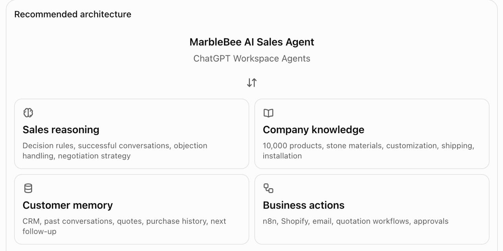

# MarbleBee AI sales agent (Luna's idea, not started)

Status: **idea only, no request or scope yet** (received 2026-10-28). Nothing built.

## What Luna sent

Luna forwarded a ChatGPT-generated architecture and text with "also, check this out", and no explicit question.

The proposed "MarbleBee AI Sales Agent" has four parts:

1. **Sales reasoning**: decision rules, successful conversations, objection handling, negotiation strategy.
2. **Company knowledge**: 10,000 products, stone materials, customization, shipping, installation.
3. **Customer memory**: CRM, past conversations, quotes, purchase history, next follow-up.
4. **Business actions**: n8n, Shopify, email, quotation workflows, approvals.

The accompanying text splits the goal into three capabilities and says that giving an AI more storage is not the same as teaching it to think like the best salesperson:

- **Company intelligence**: products, materials, prices, customization capabilities, shipping, installation, policies.
- **Human sales judgment**: how the strongest salesperson qualifies clients, handles objections, negotiates and decides the next step.
- **Long-term customer memory**: each client's project, conversations, quotations, preferences, purchase history.

It also claims OpenAI introduced "ChatGPT Workspace Agents" on April 22, 2026 (not verified, do not repeat as fact).

## Our reading of what she wants

An assistant that answers customer inquiries and drafts quotes the way her best salesperson would, remembers each client, and can trigger actions through n8n and Shopify. This is an inference; she has not said it.

## Open questions for Luna

1. Is this a project to scope now, or ideas she is collecting for later?
2. What is the first problem to solve: faster replies to inquiries, quoting, or follow-ups?
3. Who is the "best salesperson", and can we get real example conversations (needed for the sales-judgment part)?

## What we already have that helps

- Product data: the Shopify sync and the "Auto sync shopify 2026" sheet (titles, descriptions, prices, dimensions, images, CAD drawings).
- n8n workflows and the Shopify Admin API connection.
- Not available yet: a CRM, quote history, and example sales conversations.

## Reply sent to Luna (2026-10-28)

> Hi Luna,
>
> Thank you for sharing this. I read it carefully, and I think the direction is right.
>
> My approach would be to start from your business goals, work out what will actually move sales and save time, and then recommend what to build, in what order. The AI sales agent can be one part of that, if the numbers support it.
>
> What you described has three layers:
>
> 1. *Company knowledge*: products, materials, prices, shipping and policies. The Shopify and sheet work already gives us a strong base.
> 2. *Client memory*: each client's project, conversations, quotes and follow-ups. We already collect client emails and attachments into sheets. Is that the full set of customer information, or do you also keep it elsewhere, for example in a CRM, quotation tool, order records or notes?
> 3. *Sales judgment*: how your best salesperson qualifies clients, handles objections and negotiates. This needs real examples to learn from.
>
> To give you a useful recommendation, I'd like to understand:
>
> 1. *Customer data*: Where does it live today, beyond the emails in the sheets?
> 2. *Sales process*: Who handles inquiries and quotes now, and could I review a few past conversations and quotes?
> 3. *Priority*: Is the biggest gap today the speed of replies, quoting, or follow-up with past clients?
> 4. *Timing*: Do you want a plan for this now, or are you collecting ideas for later?
>
> With your answers, I'll send a short proposal covering the opportunity, the approach, and the steps. I won't start building anything until we've agreed it's worth it.

Awaiting Luna's answers. Note: the customer-data question appears twice (layer 2 and question 1).

## Existing work to build on (from reading workflows/axe-ai, not yet checked live)

- Email ingestion: per-client Drive folder, attachments subfolder and conversation sheet, logged per message without duplicates (workflows/axe-ai/email-ingestion, message-processors).
- AI responder: stores clients, contacts, messages, attachments, documents and AI-summarized cases (title, summary, status) in Supabase with embeddings, and drafts replies from past cases (workflows/axe-ai/ai-responder).
- Product knowledge search: workflows/axe-ai/rag.
- Not seen: structured quotes, purchase history from Shopify orders, follow-up due dates, sales-judgment examples. Whether these workflows are running today has not been checked.

## Luna's reply (2026-10-28)

> I still need time to think through. i need two system. One is connect to chatgpt. the other option, I want to try a local model like qwen one day.

Reading: she wants the agent in two forms, a hosted one connected to ChatGPT and a local one on a model she runs herself (like Qwen), the local one being exploratory, not urgent. Both can share one foundation (product knowledge, client history, sales examples); only the model on top differs. Local models need her own hardware and setup, and quality must be tested on real questions first (not yet researched). No decision yet.

## Our answer (2026-10-28, cost deliberately left out for now)

> Hi Luna,
>
> No problem, take your time.
>
> Both options can work. I'd build the foundation once, with your product knowledge, client history and sales examples. Then we can connect it to ChatGPT first and try a local model like Qwen later, with minimal rework.
>
> Whenever you're ready, I can compare the options with you, so you know the quality and trade-offs before you decide.
>
> Thanks,
> Bilal

Waiting for Luna. Still open from the first message: where customer data lives, who handles quotes, priority, timing.
